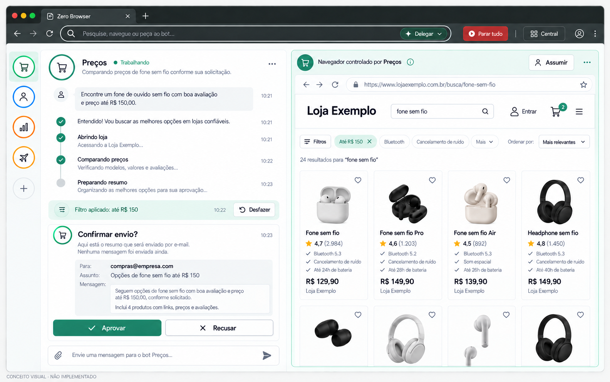

# Conceito visual — modo Delegar

**Versão de referência:** 0.1.45-dev

**Estado:** imagem conceitual; não implementada nem aceita como interface final.

O layout segue a direção aprovada no plano de design do projeto: uma barra de comando para pesquisar, navegar ou delegar; conversa com o Bot à esquerda; aba controlada ao vivo à direita; trilho compacto com avatares de traço dentro de anéis coloridos; e os controles de **Parar tudo**, **Central**, **Assumir**, aprovação e **Desfazer** visíveis no contexto.

A aprovação é uma prévia: o mockup deixa claro que a mensagem ainda não foi enviada. O botão **Desfazer** se refere apenas ao filtro reversível da página. A tela usa uma loja e dados fictícios só para ilustrar a relação entre conversa, página controlada e aprovação.

Este artefato não afirma que esses controles existam na interface atual. O plano de design que orientou a imagem está na worktree de análise `.claude/worktrees/analise-projeto-atual-bf8fc8/docs/PLANO_DESIGN_UX.md`, seção 11c; esse arquivo ainda não está versionado na branch `main` deste checkout.

Próximo passo de design: transformar o mockup aprovado em protótipo clicável dos fluxos de delegar, aprovar e assumir o controle, e testar a compreensão com usuários antes de implementar a interface de produção.
